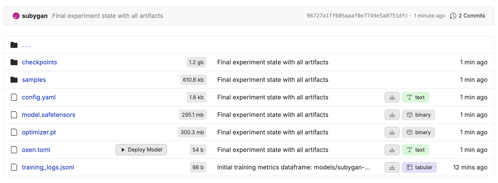
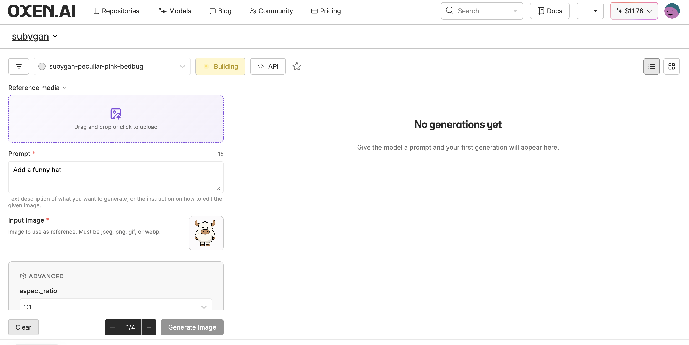

Any directory that contains an `oxen.toml` with a valid `[model]` section becomes deployable from the Oxen.ai UI. Browse to the folder and a **Deploy Model** button appears alongside the file listing. Clicking it provisions a dedicated inference endpoint using the settings in `oxen.toml`.

Below is an example of the deploy model button:



## The `oxen.toml` file

Place the file at the root of the directory you want to deploy. Only one `[model]` section is required.

```toml oxen.toml
[model]
source = "Qwen/Qwen3-8B"
type   = "lora"
```

| Field | Required | Description |
|---|---|---|
| `source` | yes | The base model this directory was trained from. Accepts a HuggingFace ID (e.g. `Qwen/Qwen3-8B`) or an Oxen model name. |
| `type` | yes | Either `"lora"` (LoRA adapter weights only) or `"full"` (full model weights). |

## What goes in the folder

Give each model a folder of its own, holding `oxen.toml` next to the weights. The deployment downloads the weights by file name, so the names have to match exactly:

| `type` | Base model | Files the folder needs |
|---|---|---|
| `"lora"` | Image or video model | `model.safetensors` |
| `"lora"` | Text model | `adapter_config.json` and `adapter_model.safetensors` |
| `"full"` | Any | The full model weights |

A LoRA saved under another name, such as `my_style_000007000.safetensors`, has to be renamed to `model.safetensors` before you push it.

## Examples

### LoRA adapter

A directory containing LoRA weights trained on top of a supported base model:

```toml oxen.toml
[model]
source = "Qwen/Qwen3-8B"
type   = "lora"
```

### Full fine-tune

A directory containing full model weights:

```toml oxen.toml
[model]
source = "meta-llama/Llama-3.2-3B-Instruct"
type   = "full"
```

### Image model

The `source` field works for any supported base model, including image and video models:

```toml oxen.toml
[model]
source = "black-forest-labs/FLUX.1-dev"
type   = "lora"
```

## The UI workflow

1. Push a directory containing model weights and an `oxen.toml` to your repository.
2. Navigate to that directory in the Oxen.ai UI.
3. Click **Deploy Model**. Oxen.ai reads `oxen.toml`, resolves the base model, and spins up a dedicated endpoint.
4. Once the deployment is live, use the returned model name with the [Inference API](/inference-api/overview) or the in-browser playground.

Below is an example of the deployment status in the workbench view after clicking Deploy Model:



Redeploying from the same directory and revision reuses the existing deployment rather than creating a duplicate.

## Finding and naming your model

Every deployment gets a generated name made of your team's name and three words, such as `acme-grim-lime-monkey`. This is the name you pass as `model` in inference requests, and it does not change. Right after you click **Deploy Model**, the name is in the workbench address bar as `?model=<name>`.

You can give the model a readable display name through the API:

```bash
curl -X PUT https://hub.oxen.ai/api/ai/models/acme-grim-lime-monkey \
  -H "Authorization: Bearer $OXEN_API_KEY" \
  -H "Content-Type: application/json" \
  -d '{"display_name": "Ghostcat Style"}'
```

## Deploying through the API

The **Deploy Model** button calls one endpoint, which you can call yourself. `path` is the folder that holds `oxen.toml`, and `revision` is the branch or commit to deploy from.

```bash
curl -X POST https://hub.oxen.ai/api/repos/acme/my-loras/deploy \
  -H "Authorization: Bearer $OXEN_API_KEY" \
  -H "Content-Type: application/json" \
  -d '{"path": "ghostcat-style", "revision": "main"}'
```

Output:

```json
{
  "status": "success",
  "status_message": "resource_created",
  "redeployed": false,
  "deployment": {
    "id": "d5f81406-959a-4eab-8c6b-423b0a81259a",
    "model_name": "acme-grim-lime-monkey",
    "status": "deploying"
  }
}
```

The response includes more fields than shown here. Keep `deployment.model_name` and `deployment.id`. A deployment takes a few minutes to start, and you can poll its status until it reads `active`:

```bash
curl https://hub.oxen.ai/api/ai/deployments/d5f81406-959a-4eab-8c6b-423b0a81259a \
  -H "Authorization: Bearer $OXEN_API_KEY"
```

Once it is active, use the model name with the [Inference API](/inference-api/overview) like any other model:

```bash
curl -X POST https://hub.oxen.ai/api/ai/queue \
  -H "Authorization: Bearer $OXEN_API_KEY" \
  -H "Content-Type: application/json" \
  -d '{"model": "acme-grim-lime-monkey", "prompt": "a cat on a windowsill", "width": 1344, "height": 768}'
```

## Cost

A deployment runs on a dedicated GPU and is billed per second for as long as it is active, whether or not it is serving requests. Deactivate it when you are done, and activate it again when you need it:

```bash
curl -X POST https://hub.oxen.ai/api/ai/models/acme-grim-lime-monkey/deactivate \
  -H "Authorization: Bearer $OXEN_API_KEY"
```

Activating it again takes a few minutes, the same as the first deploy:

```bash
curl -X POST https://hub.oxen.ai/api/ai/models/acme-grim-lime-monkey/activate \
  -H "Authorization: Bearer $OXEN_API_KEY"
```

## Common errors

| Message | Cause |
|---|---|
| `oxen.toml not found at <path>/oxen.toml` | No `oxen.toml` in the directory you're trying to deploy. |
| `oxen.toml must contain a [model] section` | File parsed but the top-level `[model]` table is missing. |
| `oxen.toml missing required field: model.source` | `source` is not set. |
| `oxen.toml model.type must be "lora" or "full"` | `type` is set to something other than `"lora"` or `"full"`. |
| `Source model not found: <source>` | The `source` doesn't match any HuggingFace ID or Oxen model name Oxen.ai currently supports. Contact [hello@oxen.ai](mailto:hello@oxen.ai) to request support for a new base model. |
